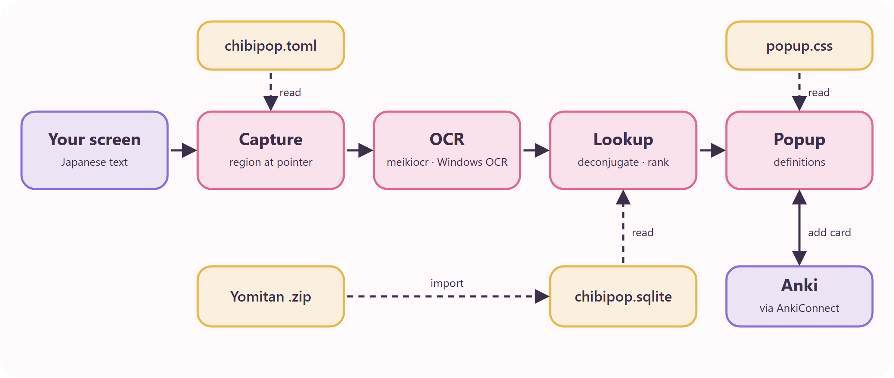

<div align="center">

# ♡ chibipop ♡

English · [简体中文](README.zh-CN.md) · [繁體中文](README.zh-TW.md)

`chibipop` for Windows and Linux (≧∀≦)

</div>

point at a word to become dekiru 


---
## FAQ so that people dont scroll down
1. Q: can you add this feature A: go to issues 
2. Q: can you fix x A: go to issues
3. Q: can you add x language support A: go to issues
4. Q: can you add x plugin from y A: go to issues
5. Q: can you find me a wife A: go to issues

### chibipop is in active development and has a rapid release cycle - we may break stuff from time-to-time (who doesnt)
**now that you have read all of the above, proceed**
---

> Unofficial. This project has no tie to Yomitan, Anki, or meikiocr. This README describes v0.9.14.

## What is this?

chibipop is a popup dictionary for Japanese. Point at a Japanese word on your screen, and a small window shows what it means. It works on games, videos, and images too, where you cannot select text.

It has two parts:

- **The lookup program.** It reads the text near your pointer and finds the word in your dictionaries.
- **The settings window.** You add dictionaries, choose keys, and connect Anki here.

The popup shows how to read the word, what it means, its pitch accent, and how common it is ♡

<p align="center"></p>

## What you need

- Windows 10 or 11, or Linux with a Wayland desktop: Hyprland, Sway, or KDE Plasma.
- On Windows: Japanese text recognition. Install Japanese in Windows Settings under Time & language. Make sure the OCR feature is on.
- On Linux: a Japanese font such as Noto Sans CJK, and a recent system (glibc 2.39 or newer).
- A dictionary file. chibipop has no dictionary built in. [Jitendex](https://jitendex.org/pages/downloads.html) is a good start. Download **Jitendex for Yomitan**. Keep it as a `.zip` file. Do not unzip it.
- Optional: Anki with the [AnkiConnect](https://ankiweb.net/shared/info/2055492159) add-on, to make flashcards.

## Install

### 1. Download

Get the file for your system from [Releases](https://github.com/stellarie/chibipop/releases).

| System | File |
|---|---|
| Windows | `chibipop-vX.Y.Z-windows-x64.zip` |
| Linux | `chibipop-vX.Y.Z-linux-x64.tar.gz` |

On Windows, right-click the zip and choose **Extract All**. On Linux, run:

```bash
tar xzf chibipop-vX.Y.Z-linux-x64.tar.gz
```

You get a folder with `chibipop` in it (`chibipop.exe` on Windows). On Nix, `nix run github:stellarie/chibipop -- run` does steps 1 and 3 for you.

### 2. Add a dictionary

On Windows, double-click `chibipop.exe`. On Linux, run:

```bash
./chibipop settings
```

Open the **Dictionaries** tab. On Windows, click **Add…**, pick your dictionary `.zip` file, and click **Apply**. On Linux, click **Browse…**, pick the file, and click **Rebuild**. The first build can take a few minutes.

### 3. Start

On Windows, lookup starts when the build ends. On Linux, run:

```bash
./chibipop run
```

Keep the terminal open. The line `worker: pipeline up` means chibipop is ready.

### 4. Read a word

Put the pointer on Japanese text. In the default mode, **Follow pointer**, the popup follows your pointer.

No popup? Add a dictionary, wait for the build to finish, and check the lookup mode on the **Shortcuts** tab.

## Lookup modes

| Mode | What it does |
|---|---|
| **Follow pointer** | The popup follows your pointer. This is the default. |
| **While held** | Lookup works while you hold a key. |
| **Turn on / off** | One key press starts lookup. The next press stops it. |
| **Once per press** | Each key press looks up one word. |

On Windows, chibipop reads your lookup key by itself. On Linux, your desktop must send the key to chibipop. Set up a Bind in the **Shortcuts** tab. The tab shows the exact lines to paste into your desktop settings. This example is for Hyprland, with a Bind named `my-lookup`:

```text
bind = ALT, F, exec, chibipop ctl bind-down my-lookup
bindr = ALT, F, exec, chibipop ctl bind-up my-lookup
```

**While held** needs both lines. **Turn on / off** needs the first line only.

## Features

| Feature | What it does |
|---|---|
| Anki cards | Adds a card from the popup, with the sentence and a screenshot if you want. |
| Dictionary search | Type a word to look it up. |
| Sentence search | Paste a sentence, then click any word in it. |
| Selected text | Looks up text that you selected, without reading the screen. |
| Copy screen text | Copies the text in an area you pick to the clipboard. |
| Profiles | Save different settings for different uses. |
| Themes | Change how the popup looks. Four themes are in [`themes/`](themes/). |
| OCR plugins | Windows only. A plugin swaps in another text reader. |

The [guide](docs/GUIDE.md) explains each feature step by step.

## Privacy and safety (｀ω´)ゞ

chibipop reads the text around your pointer.

- **Treat saved screenshots as private.** An Anki card can include a screenshot. chibipop keeps a copy in the `screenshots` folder. Anki keeps another copy.
- A plugin is a separate program with your full user rights. Add only plugins that you trust.
- chibipop uses the internet in one case: when you click **Check for updates**. On Windows, it can then replace `chibipop.exe` with the new version.
- Anki cards go to AnkiConnect on your own computer, at `http://localhost:8765` unless you change it.
- chibipop never downloads a model on the first run.

> GNOME cannot show the popup yet. The older X11 system is not supported.

> Vertical text is in beta. It can miss the first character.

## Settings

| Setting | Where to change it | Default |
|---|---|---|
| Lookup mode | **Shortcuts** tab | **Follow pointer** |
| Screen area size | **Text recognition** tab | 500 × 100 pixels |
| Anki address | **Anki** tab | `http://localhost:8765` |
| Screenshot folder | **Anki** tab on Linux. `save_dir` in `chibipop.toml` on Windows. | `screenshots` |
| Popup style | A `popup.css` file next to the settings file | built-in style |
| Settings file | `chibipop.toml` next to the program on Windows. `~/.config/chibipop/` on Linux. | made on the first run |

The [guide](docs/GUIDE.md) covers every setting.

## Build it yourself

Install [Rust](https://rustup.rs) stable. Both builds make a file named `chibipop`, so a command must skip the other build.

```bash
cargo build --release -p chibipop-windows   # Windows
cargo build --release -p chibipop-linux     # Linux
cargo test --workspace --exclude chibipop-linux     # Windows
cargo test --workspace --exclude chibipop-windows   # Linux
```

## License

GPL-3.0-or-later © stellarie. Made with ♡ (≧∀≦)

The Linux build includes the [meikiocr](https://github.com/rtr46/meikiocr) models, which are LGPL-3.0. See [`LICENSE.md`](crates/chibipop-linux/models/meiki/LICENSE.md). Both builds include the IPADIC model. See [`COPYING`](data/ipadic/COPYING) and [`NOTICE`](data/ipadic/NOTICE). Dictionaries are not included. Each has its own license.
