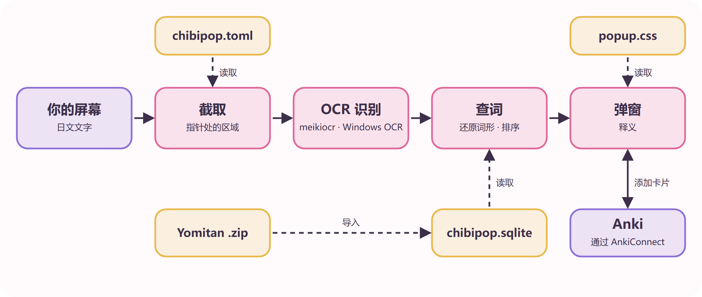

<div align="center">

# ♡ chibipop ♡

[English](README.md) · 简体中文 · [繁體中文](README.zh-TW.md)

适用于 Windows 和 Linux 的 `chibipop` (≧∀≦)

</div>

指向一个词，就能变成 dekiru


---
## FAQ，省得大家往下翻
1. Q: 能加这个功能吗 A: 去 issues
2. Q: 能修一下 x 吗 A: 去 issues
3. Q: 能支持 x 语言吗 A: 去 issues
4. Q: 能加 y 的 x 插件吗 A: 去 issues
5. Q: 能帮我找个老婆吗 A: 去 issues

### chibipop 正在积极开发，发布节奏很快，偶尔可能会弄坏点东西（谁还没坏过呢）
**上面的都看完了，那就开始吧**
---

> 非官方项目。本项目与 Yomitan、Anki、meikiocr 没有关联。本 README 描述 v0.9.14。

## 这是什么？

chibipop 是日语弹窗词典。把指针指向屏幕上的日语单词，一个小窗口就会显示它的意思。在无法选中文字的游戏、视频和图片里也能用。

它有两部分：

- **查词程序。** 它读取指针附近的文字，并在你的词典中找到这个词。
- **设置窗口。** 你在这里添加词典、选择按键和连接 Anki。

弹窗会显示这个词怎么读、是什么意思、音调，以及它有多常用 ♡

<p align="center"></p>

## 你需要什么

- Windows 10 或 11，或者使用 Wayland 桌面的 Linux：Hyprland、Sway 或 KDE Plasma。
- 在 Windows 上：日语文字识别。在 Windows 设置的 Time & language 下安装日语。确认 OCR 功能已开启。
- 在 Linux 上：一款日语字体，例如 Noto Sans CJK，以及较新的系统（glibc 2.39 或更新版本）。
- 一个词典文件。chibipop 没有内置词典。[Jitendex](https://jitendex.org/pages/downloads.html) 是不错的起点。下载 **Jitendex for Yomitan**。保持它为 `.zip` 文件，不要解压。
- 可选：安装了 [AnkiConnect](https://ankiweb.net/shared/info/2055492159) 插件的 Anki，用来制作记忆卡片。

## 安装

### 1. 下载

从 [Releases](https://github.com/stellarie/chibipop/releases) 获取适合你系统的文件。

| 系统 | 文件 |
|---|---|
| Windows | `chibipop-vX.Y.Z-windows-x64.zip` |
| Linux | `chibipop-vX.Y.Z-linux-x64.tar.gz` |

在 Windows 上，右键单击 zip 文件并选择 **Extract All**。在 Linux 上，运行：

```bash
tar xzf chibipop-vX.Y.Z-linux-x64.tar.gz
```

你会得到一个文件夹，里面有 `chibipop`（Windows 上是 `chibipop.exe`）。在 Nix 上，`nix run github:stellarie/chibipop -- run` 会替你完成第 1 步和第 3 步。

### 2. 添加词典

在 Windows 上，双击 `chibipop.exe`。在 Linux 上，运行：

```bash
./chibipop settings
```

打开 **Dictionaries** 标签页。在 Windows 上，点击 **Add…**，选择你的词典 `.zip` 文件，然后点击 **Apply**。在 Linux 上，点击 **Browse…**，选择文件，然后点击 **Rebuild**。首次构建可能需要几分钟。

### 3. 启动

在 Windows 上，构建结束后查词会自动开始。在 Linux 上，运行：

```bash
./chibipop run
```

保持终端打开。看到 `worker: pipeline up` 这一行，就说明 chibipop 已就绪。

### 4. 读一个词

把指针放在日语文字上。在默认模式 **Follow pointer** 下，弹窗会跟着你的指针。

没有弹窗？请添加词典，等待构建完成，并检查 **Shortcuts** 标签页中的查词模式。

## 查词模式

| 模式 | 作用 |
|---|---|
| **Follow pointer** | 弹窗跟着你的指针。这是默认模式。 |
| **While held** | 按住按键时可以查词。 |
| **Turn on / off** | 按一次键开始查词，再按一次停止。 |
| **Once per press** | 每按一次键查一个词。 |

在 Windows 上，chibipop 自己读取你的查词键。在 Linux 上，你的桌面必须把按键发送给 chibipop。在 **Shortcuts** 标签页中设置一个 Bind。该标签页会显示要粘贴到桌面配置中的确切内容。下面的示例适用于 Hyprland，Bind 名为 `my-lookup`：

```text
bind = ALT, F, exec, chibipop ctl bind-down my-lookup
bindr = ALT, F, exec, chibipop ctl bind-up my-lookup
```

**While held** 需要两行。**Turn on / off** 只需要第一行。

## 功能

| 功能 | 作用 |
|---|---|
| Anki 卡片 | 从弹窗添加卡片，附带例句，也可以附带截图。 |
| 词典搜索 | 输入一个词来查询。 |
| 句子搜索 | 粘贴一个句子，然后点击其中任意一个词。 |
| 选中文本 | 查询你选中的文本，无需读取屏幕。 |
| 复制屏幕文字 | 把你选定区域中的文字复制到剪贴板。 |
| 配置档案 | 为不同用途保存不同的设置。 |
| 主题 | 改变弹窗的外观。[`themes/`](themes/) 中有四个主题。 |
| OCR 插件 | 仅限 Windows。插件可以换用另一个文字读取器。 |

[指南](docs/GUIDE.md)会一步一步地说明每个功能。

## 隐私与安全 (｀ω´)ゞ

chibipop 会读取指针周围的文字。

- **请把保存的截图视为私密内容。** Anki 卡片可以包含截图。chibipop 会在 `screenshots` 文件夹中保留一份副本。Anki 会再保留一份副本。
- 插件是拥有你完整用户权限的独立程序。只添加你信任的插件。
- chibipop 只在一种情况下使用互联网：当你点击 **Check for updates** 时。在 Windows 上，它随后可以用新版本替换 `chibipop.exe`。
- Anki 卡片会发送到你自己电脑上的 AnkiConnect，地址是 `http://localhost:8765`，除非你修改它。
- chibipop 从不在首次运行时下载模型。

> GNOME 暂时无法显示弹窗。不支持较旧的 X11 系统。

> 竖排文字为测试版。它可能漏掉第一个字符。

## 设置

| 设置 | 在哪里修改 | 默认值 |
|---|---|---|
| 查词模式 | **Shortcuts** 标签页 | **Follow pointer** |
| 屏幕区域大小 | **Text recognition** 标签页 | 500 × 100 像素 |
| Anki 地址 | **Anki** 标签页 | `http://localhost:8765` |
| 截图文件夹 | Linux 上在 **Anki** 标签页。Windows 上是 `chibipop.toml` 中的 `save_dir`。 | `screenshots` |
| 弹窗样式 | 设置文件旁边的 `popup.css` 文件 | 内置样式 |
| 设置文件 | Windows 上是程序旁边的 `chibipop.toml`。Linux 上是 `~/.config/chibipop/`。 | 首次运行时生成 |

[指南](docs/GUIDE.md)涵盖了每一项设置。

## 自己构建

安装 [Rust](https://rustup.rs) stable。两种构建都会生成名为 `chibipop` 的文件，所以命令必须跳过另一种构建。

```bash
cargo build --release -p chibipop-windows   # Windows
cargo build --release -p chibipop-linux     # Linux
cargo test --workspace --exclude chibipop-linux     # Windows
cargo test --workspace --exclude chibipop-windows   # Linux
```

## 许可证

GPL-3.0-or-later © stellarie。用 ♡ 制作 (≧∀≦)

Linux 构建包含 [meikiocr](https://github.com/rtr46/meikiocr) 模型，许可证为 LGPL-3.0。参见 [`LICENSE.md`](crates/chibipop-linux/models/meiki/LICENSE.md)。两种构建都包含 IPADIC 模型。参见 [`COPYING`](data/ipadic/COPYING) 和 [`NOTICE`](data/ipadic/NOTICE)。词典不包含在内。每部词典有各自的许可证。
