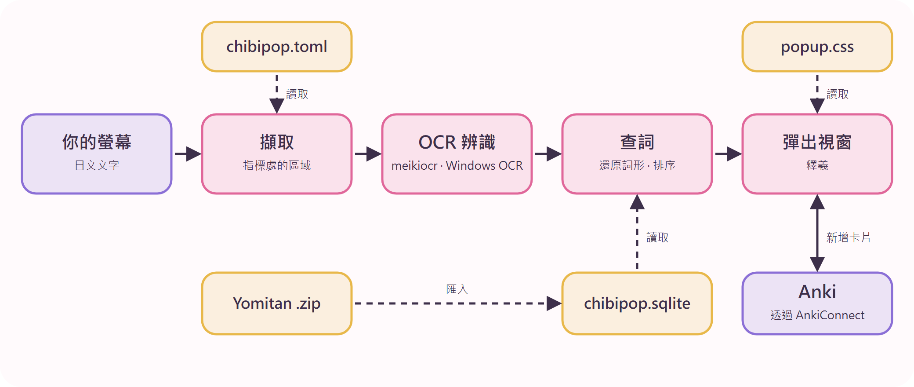

<div align="center">

# ♡ chibipop ♡

[English](README.md) · [简体中文](README.zh-CN.md) · 繁體中文

適用於 Windows 與 Linux 的 `chibipop` (≧∀≦)

</div>

指著單字，就能變成 dekiru 


---
## FAQ，這樣大家就不用往下捲了
1. 問：可以加這個功能嗎 答：去 issues 
2. 問：可以修 x 嗎 答：去 issues
3. 問：可以支援 x 語言嗎 答：去 issues
4. 問：可以加 y 的 x 外掛嗎 答：去 issues
5. 問：可以幫我找老婆嗎 答：去 issues

### chibipop 正在積極開發，發行週期很快，我們偶爾會弄壞東西（誰不會呢）
**既然你已經讀完上面所有內容，那就繼續吧**
---

> 非官方專案。本專案與 Yomitan、Anki、meikiocr 無任何關係。本 README 說明 v0.9.14。

## 這是什麼？

chibipop 是日文的彈出式辭典。用指標指著螢幕上的日文單字，就會跳出一個小視窗，告訴你它的意思。遊戲、影片和圖片這些無法選取文字的地方也能用。

它有兩個部分：

- **查詢程式。** 它讀取指標附近的文字，並在你的辭典中找出這個單字。
- **設定視窗。** 你在這裡加入辭典、選擇按鍵，以及連接 Anki。

彈出視窗會顯示這個單字怎麼念、是什麼意思、音調，以及它有多常見 ♡

<p align="center"></p>

## 你需要什麼

- Windows 10 或 11，或是使用 Wayland 桌面的 Linux：Hyprland、Sway 或 KDE Plasma。
- 在 Windows 上：日文文字辨識。請在「Windows 設定」的「時間與語言」中安裝日文。並確認 OCR 功能已開啟。
- 在 Linux 上：日文字型，例如 Noto Sans CJK，以及較新的系統（glibc 2.39 或更新版本）。
- 一個辭典檔案。chibipop 沒有內建辭典。[Jitendex](https://jitendex.org/pages/downloads.html) 是不錯的起點。下載 **Jitendex for Yomitan**。保持它的 `.zip` 格式。不要解壓縮。
- 選用：安裝 [AnkiConnect](https://ankiweb.net/shared/info/2055492159) 外掛的 Anki，用來製作單字卡。

## 安裝

### 1. 下載

從 [Releases](https://github.com/stellarie/chibipop/releases) 取得適合你系統的檔案。

| 系統 | 檔案 |
|---|---|
| Windows | `chibipop-vX.Y.Z-windows-x64.zip` |
| Linux | `chibipop-vX.Y.Z-linux-x64.tar.gz` |

在 Windows 上，對 zip 按右鍵，選擇 **Extract All**。在 Linux 上，執行：

```bash
tar xzf chibipop-vX.Y.Z-linux-x64.tar.gz
```

你會得到一個資料夾，裡面有 `chibipop`（Windows 上是 `chibipop.exe`）。在 Nix 上，`nix run github:stellarie/chibipop -- run` 會幫你完成步驟 1 和 3。

### 2. 加入辭典

在 Windows 上，按兩下 `chibipop.exe`。在 Linux 上，執行：

```bash
./chibipop settings
```

開啟 **Dictionaries** 分頁。在 Windows 上，按一下 **Add…**，選你的辭典 `.zip` 檔案，再按一下 **Apply**。在 Linux 上，按一下 **Browse…**，選檔案，再按一下 **Rebuild**。第一次建置可能需要幾分鐘。

### 3. 開始

在 Windows 上，建置結束後就會開始查詢。在 Linux 上，執行：

```bash
./chibipop run
```

請保持終端機開啟。看到 `worker: pipeline up` 這一行，就代表 chibipop 準備好了。

### 4. 讀一個單字

把指標放在日文文字上。在預設模式 **Follow pointer** 下，彈出視窗會跟著你的指標。

沒有彈出視窗？請先加入辭典，等建置完成，再到 **Shortcuts** 分頁檢查查詢模式。

## 查詢模式

| 模式 | 作用 |
|---|---|
| **Follow pointer** | 彈出視窗跟著你的指標。這是預設值。 |
| **While held** | 按住按鍵時才會查詢。 |
| **Turn on / off** | 按一次開始查詢。再按一次停止。 |
| **Once per press** | 每按一次按鍵，查詢一個單字。 |

在 Windows 上，chibipop 自己讀取你的查詢鍵。在 Linux 上，你的桌面必須把按鍵傳給 chibipop。請在 **Shortcuts** 分頁設定一個 Bind。這個分頁會顯示要貼到桌面設定中的完整內容。以下範例適用於 Hyprland，Bind 的名稱是 `my-lookup`：

```text
bind = ALT, F, exec, chibipop ctl bind-down my-lookup
bindr = ALT, F, exec, chibipop ctl bind-up my-lookup
```

**While held** 需要兩行。**Turn on / off** 只需要第一行。

## 功能

| 功能 | 作用 |
|---|---|
| Anki 卡片 | 從彈出視窗新增卡片，附上例句，也可以附上螢幕截圖。 |
| 辭典搜尋 | 輸入單字來查詢。 |
| 句子搜尋 | 貼上一個句子，再點選句子裡的任何單字。 |
| 選取文字 | 查詢你選取的文字，不需要讀取螢幕。 |
| 複製螢幕文字 | 把你框選區域中的文字複製到剪貼簿。 |
| 設定組合 | 為不同的用途儲存不同的設定。 |
| 佈景主題 | 改變彈出視窗的外觀。[`themes/`](themes/) 內有四個佈景主題。 |
| OCR 外掛 | 僅限 Windows。外掛可換成另一個文字讀取器。 |

[指南](docs/GUIDE.md)會一步一步說明每項功能。

## 隱私與安全 (｀ω´)ゞ

chibipop 會讀取你指標周圍的文字。

- **請將儲存的螢幕截圖視為私人資料。** Anki 卡片可以包含螢幕截圖。chibipop 會在 `screenshots` 資料夾中保留一份副本。Anki 會再保留另一份。
- 外掛是獨立的程式，擁有你完整的使用者權限。只加入你信任的外掛。
- chibipop 只在一種情況下使用網路：當你按一下 **Check for updates** 時。在 Windows 上，之後它可以用新版本取代 `chibipop.exe`。
- Anki 卡片會送到你自己電腦上的 AnkiConnect，位址是 `http://localhost:8765`，除非你更改它。
- chibipop 絕不會在第一次執行時下載模型。

> GNOME 目前還無法顯示彈出視窗。不支援較舊的 X11 系統。

> 直排文字為 beta 功能。它可能會漏掉第一個字。

## 設定

| 設定項目 | 在哪裡更改 | 預設值 |
|---|---|---|
| 查詢模式 | **Shortcuts** 分頁 | **Follow pointer** |
| 螢幕區域大小 | **Text recognition** 分頁 | 500 × 100 像素 |
| Anki 位址 | **Anki** 分頁 | `http://localhost:8765` |
| 螢幕截圖資料夾 | Linux 上為 **Anki** 分頁。Windows 上為 `chibipop.toml` 中的 `save_dir`。 | `screenshots` |
| 彈出視窗樣式 | 設定檔旁的 `popup.css` 檔案 | 內建樣式 |
| 設定檔 | Windows 上為程式旁的 `chibipop.toml`。Linux 上為 `~/.config/chibipop/`。 | 第一次執行時建立 |

[指南](docs/GUIDE.md)涵蓋每一項設定。

## 自己建置

安裝 [Rust](https://rustup.rs) stable。兩種建置都會產生名為 `chibipop` 的檔案，所以指令必須略過另一種建置。

```bash
cargo build --release -p chibipop-windows   # Windows
cargo build --release -p chibipop-linux     # Linux
cargo test --workspace --exclude chibipop-linux     # Windows
cargo test --workspace --exclude chibipop-windows   # Linux
```

## 授權

GPL-3.0-or-later © stellarie. 以 ♡ 製作 (≧∀≦)

Linux 版本內含 [meikiocr](https://github.com/rtr46/meikiocr) 模型，授權為 LGPL-3.0。請見 [`LICENSE.md`](crates/chibipop-linux/models/meiki/LICENSE.md)。兩個版本都內含 IPADIC 模型。請見 [`COPYING`](data/ipadic/COPYING) 和 [`NOTICE`](data/ipadic/NOTICE)。不附辭典。每本辭典有各自的授權。
